# Lab5Web - Praktikum 5: JavaScript Dasar dan Manipulasi HTML


 **Mata Kuliah**  Pemrograman Web
 
 **Nama**  Naifah Alya Kamilah 
 
 **NIM**  312510193 
 
 **Kelas**  I251B 


## Deskripsi

Repository ini berisi hasil Praktikum 5 (JavaScript Dasar dan Manipulasi HTML). Materi yang dipraktikkan: **variabel, tipe data, operator, percabangan (if-else dan switch), perulangan, function, output (console, alert, prompt, elemen HTML), DOM, event, form, dan validasi input**. Berbeda dari praktikum sebelumnya yang berfokus pada HTML, pada praktikum ini JavaScript dipakai untuk membuat halaman web bersifat interaktif.

## Tujuan Praktikum

1. Memahami sintaks dasar JavaScript dan cara menyisipkan JavaScript pada HTML.
2. Menggunakan variabel, tipe data, operator, percabangan, perulangan, dan function.
3. Menampilkan informasi melalui console, alert, prompt, dan elemen HTML.
4. Memanipulasi konten serta gaya elemen HTML menggunakan JavaScript.
5. Membuat interaksi sederhana pada form dan melakukan validasi input.
6. Mendokumentasikan pekerjaan praktikum beserta hasil pengujiannya.

## Struktur Repository

Setiap latihan terdiri atas satu berkas HTML dan satu berkas JavaScript eksternal dengan nama yang sama, sehingga hasil tiap latihan berdiri sendiri dan tidak bercampur.

## Langkah-langkah Praktikum

### Persiapan

1. Menyiapkan Visual Studio Code dan web browser (Chrome/Edge).
2. Membuat folder kerja `Lab5Web` lalu membukanya melalui **File → Open Folder** di VS Code.
3. Memasang extension **Live Server** (pembuat Ritwick Dey) agar halaman otomatis dimuat ulang setiap file disimpan.
4. Membuat pasangan file `latihanN.html` dan `latihanN.js` untuk setiap latihan.
5. Menghubungkan JavaScript ke HTML dengan `<script src="latihanN.js"></script>` di **akhir `<body>`**, agar elemen HTML sudah tersedia sebelum script berjalan.
6. Membuka Console melalui **Ctrl + Shift + J** (tombol F12 pada perangkat ini dipakai fungsi sistem, sehingga diganti dengan pintasan tersebut).
7. Setiap selesai mengubah kode, file disimpan (Ctrl+S) dan halaman di-refresh (F5) untuk melihat hasilnya.

Kerangka HTML yang dipakai pada semua latihan:

```html
<!DOCTYPE html>
<html lang="id">
<head>
  <meta charset="UTF-8">
  <meta name="viewport" content="width=device-width, initial-scale=1.0">
  <title>Latihan N</title>
</head>
<body>
  <h1>Judul Latihan</h1>
  <p id="pesan">Konten awal.</p>

  <script src="latihanN.js"></script>
</body>
</html>
```

---

### 1. Latihan 1: Menampilkan Output

**Tujuan:** mengenali cara menampilkan output di halaman dan di Console.

**Kode (`latihan1.js`):**

```js
document.getElementById("pesan").textContent = "Hello World";
console.log("Hello World");
```

**Penjelasan:**
- `document` adalah objek yang mewakili seluruh halaman HTML.
- `getElementById("pesan")` mencari elemen yang memiliki `id="pesan"` dan mengembalikan elemen tersebut.
- `textContent` adalah properti untuk membaca atau mengubah teks di dalam elemen. Nilai baru langsung tampil di halaman.
- `console.log()` mencetak pesan ke Console browser, yang hanya terlihat oleh developer.

**Hasil pengamatan:** teks "Konten awal." pada halaman berubah menjadi "Hello World", dan pada Console muncul tulisan `Hello World`.

**Perbedaan output:** output pada halaman dapat dilihat oleh semua pengguna, sedangkan output pada Console hanya terlihat saat panel developer dibuka dan umumnya dipakai untuk debugging.

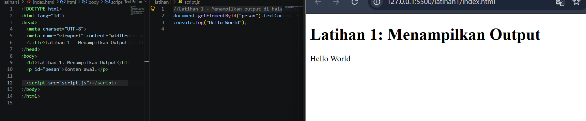

---

### 2. Latihan 2: Alert dan Prompt

**Tujuan:** menggunakan kotak dialog untuk menampilkan pesan dan meminta masukan pengguna.

**Kode (`latihan2.js`):**

```js
const namaPengguna = prompt("Masukkan nama Anda:", "");

if (namaPengguna && namaPengguna.trim() !== "") {
  alert("Halo, " + namaPengguna + "!");
  document.getElementById("pesan").textContent = "Selamat datang, " + namaPengguna + ".";
} else {
  alert("Nama belum diisi.");
}
```

**Penjelasan:**
- `prompt()` menampilkan kotak input dan mengembalikan teks yang diketik (string). Jika pengguna menekan Cancel, hasilnya `null`.
- `alert()` menampilkan kotak pesan; halaman berhenti sementara sampai tombol OK ditekan.
- Kondisi `namaPengguna && namaPengguna.trim() !== ""` menangani dua kasus gagal sekaligus: `null` (Cancel) dan string kosong atau hanya spasi. `trim()` membuang spasi di awal dan akhir.
- Operator `+` pada string digunakan untuk menggabungkan teks (konkatenasi).

**Hasil pengujian:**

| Skenario | Perilaku Program |
|---|---|
| Mengetik nama (misalnya `Naifah`) lalu OK | Alert "Halo, Naifah!", lalu teks halaman berubah menjadi "Selamat datang, Naifah." |
| Menekan Cancel | `prompt` mengembalikan `null`, muncul alert "Nama belum diisi." |
| Membiarkan kosong lalu OK | `prompt` mengembalikan string kosong, muncul alert "Nama belum diisi." |

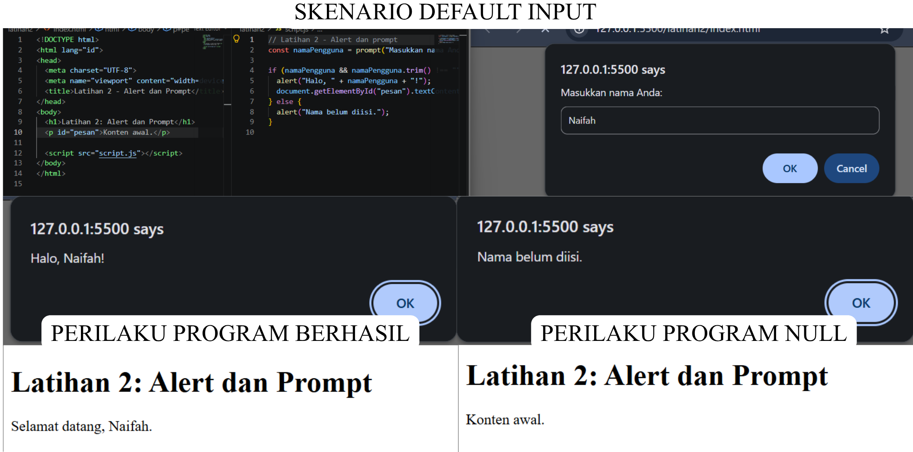

---

### 3. Latihan 3: Function dan Operasi Aritmetika

**Tujuan:** membuat function dengan parameter dan memakai operator aritmetika.

**Kode (`latihan3.js`):**

```js
function operasiDasar(a, b) {
  console.log("Penjumlahan:", a + b);
  console.log("Pengurangan:", a - b);
  console.log("Perkalian:", a * b);
  console.log("Pembagian:", b !== 0 ? a / b : "Tidak dapat dibagi nol");
  console.log("Modulus:", a % b);
}

operasiDasar(9, 4);
```

**Penjelasan:**
- `function operasiDasar(a, b)` mendefinisikan function dengan dua parameter, `a` dan `b`. Function baru berjalan saat dipanggil, yaitu pada `operasiDasar(9, 4)`.
- Operator aritmetika: `+` tambah, `-` kurang, `*` kali, `/` bagi, `%` sisa bagi (modulus).
- `b !== 0 ? a / b : "..."` adalah operator ternary: jika `b` bukan nol maka dihitung `a / b`, jika tidak maka tampil pesan.

**Hasil pengamatan (`operasiDasar(9, 4)`):**

| Operasi | Hasil |
|---|---|
| Penjumlahan | 13 |
| Pengurangan | 5 |
| Perkalian | 36 |
| Pembagian | 2.25 |
| Modulus | 1 |

**Temuan tambahan:** pada `operasiDasar(10, 0)`, pembagian menampilkan "Tidak dapat dibagi nol", tetapi modulus menghasilkan `NaN` karena `10 % 0` tidak terdefinisi dan belum dijaga oleh kondisi apa pun. Perbaikannya diterapkan pada Eksperimen 1.

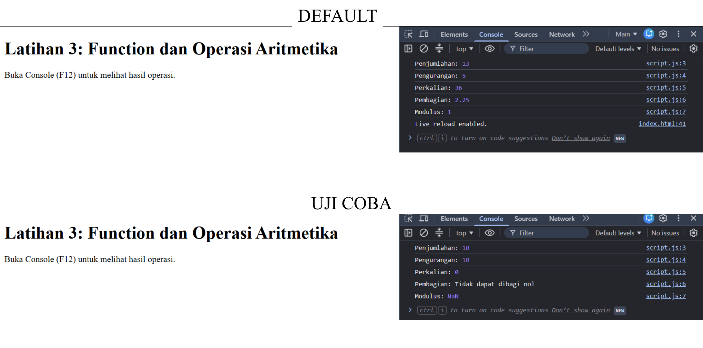

---

### 4. Latihan 4: Seleksi Kondisi if-else

**Tujuan:** menentukan kelulusan berdasarkan nilai dan memvalidasi input.

**Kode (`latihan4.js`):**

```js
const inputNilai = prompt("Masukkan nilai (0–100):");
const nilaiMahasiswa = Number(inputNilai);

if (inputNilai === null || inputNilai.trim() === "" ||
    Number.isNaN(nilaiMahasiswa) || nilaiMahasiswa < 0 || nilaiMahasiswa > 100) {
  alert("Input nilai tidak valid.");
} else if (nilaiMahasiswa >= 60) {
  alert("Lulus");
} else {
  alert("Belum lulus");
}
```

**Penjelasan:**
- `prompt` selalu menghasilkan **string**, sehingga harus dikonversi dengan `Number()` sebelum dibandingkan sebagai angka.
- `Number("abc")` menghasilkan `NaN`, yang dideteksi dengan `Number.isNaN()`.
- Tanda `||` berarti "atau": input dianggap tidak valid jika salah satu syaratnya terpenuhi (Cancel, kosong, bukan angka, di bawah 0, atau di atas 100).
- Urutan `if`, `else if`, `else` diperiksa dari atas; pemeriksaan validitas ditaruh paling atas agar input salah tidak ikut dinilai lulus atau tidak.

**Hasil pengujian:**

| Input | Hasil |
|---|---|
| `80` | Lulus |
| `60` | Lulus (nilai batas) |
| `45` | Belum lulus |
| `abc` | Input nilai tidak valid |
| `150` | Input nilai tidak valid |
| (kosong) | Input nilai tidak valid |
| Cancel | Input nilai tidak valid |

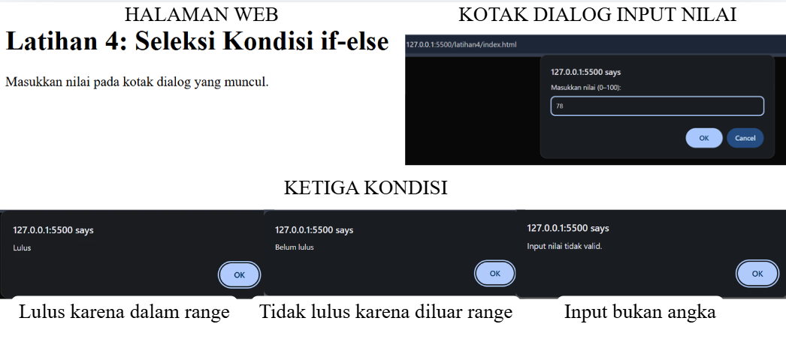

---

### 5. Latihan 5: Seleksi Kondisi switch

**Tujuan:** memilih satu tindakan dari sejumlah nilai pasti menggunakan `switch`.

**Kode (`latihan5.js`):**

```js
const inputPilihan = prompt("Masukkan angka 1–5:");

switch (inputPilihan) {
  case "1": alert("Bilangan satu"); break;
  case "2": alert("Bilangan dua"); break;
  case "3": alert("Bilangan tiga"); break;
  case "4": alert("Bilangan empat"); break;
  case "5": alert("Bilangan lima"); break;
  default: alert("Pilihan tidak tersedia");
}
```

**Penjelasan:**
- `switch` mencocokkan nilai `inputPilihan` dengan setiap `case`.
- Setiap `case` memakai tanda kutip (`"1"`) karena hasil `prompt` berupa string dan `switch` membandingkan secara ketat (tipe harus sama).
- `break` menghentikan switch setelah case yang cocok; tanpa `break`, eksekusi berlanjut ke case berikutnya.
- `default` dijalankan jika tidak ada case yang cocok.

**Hasil pengujian:**

| Input | Hasil |
|---|---|
| `1` sampai `5` | Alert "Bilangan satu" sampai "Bilangan lima" |
| `7` | Pilihan tidak tersedia |


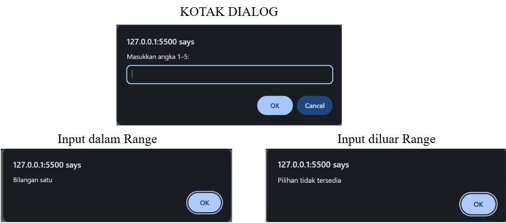

---

### 6. Latihan 6: Form Bilangan Genap atau Ganjil

**Tujuan:** membaca isi input form dan menampilkan hasil pemeriksaan di halaman.

**Kode HTML (`latihan6.html`, bagian body):**

```html
<label for="bilangan">Masukkan bilangan bulat:</label>
<input type="number" id="bilangan" step="1">
<button type="button" onclick="cekBilangan()">Periksa</button>
<p id="hasilBilangan"></p>
```

**Kode JavaScript (`latihan6.js`):**

```js
function cekBilangan() {
  const input = document.getElementById("bilangan").value;
  const angka = Number(input);
  const hasil = document.getElementById("hasilBilangan");

  if (input.trim() === "" || !Number.isInteger(angka)) {
    hasil.textContent = "Masukkan bilangan bulat yang valid.";
  } else if (angka % 2 === 0) {
    hasil.textContent = "Bilangan genap";
  } else {
    hasil.textContent = "Bilangan ganjil";
  }
}
```

**Penjelasan:**
- `onclick="cekBilangan()"` memanggil function saat tombol diklik.
- `.value` membaca isi input; nilainya selalu string sehingga dikonversi dengan `Number()`.
- `Number.isInteger(angka)` memeriksa apakah angka berupa bilangan bulat (desimal seperti 2.5 ditolak).
- Bilangan genap adalah bilangan dengan sisa bagi 2 sama dengan 0 (`angka % 2 === 0`). Untuk bilangan negatif, `-3 % 2` menghasilkan `-1`, sehingga bukan 0 dan tetap terdeteksi ganjil.
- Hasil ditulis ke elemen `<p id="hasilBilangan">` dengan `textContent`.

**Hasil pengujian:**

| Input | Hasil |
|---|---|
| `2` | Bilangan genap |
| `9` | Bilangan ganjil |
| `3.5` | Masukkan bilangan bulat yang valid. |
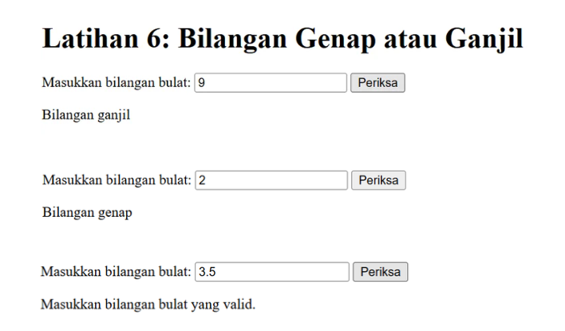

---

### 7. Latihan 7: Mengubah Warna Halaman

**Tujuan:** mengubah gaya (CSS) elemen melalui JavaScript dengan satu function berparameter.

**Kode HTML (`latihan7.html`, bagian body):**

```html
<button type="button" onclick="ubahWarnaLatar('lightgreen')">Latar Hijau</button>
<button type="button" onclick="ubahWarnaLatar('white')">Latar Putih</button>
<button type="button" onclick="ubahWarnaLatar('lightyellow')">Latar Kuning</button>
```

**Kode JavaScript (`latihan7.js`):**

```js
function ubahWarnaLatar(warna) {
  document.body.style.backgroundColor = warna;
}
```

**Penjelasan:**
- `document.body` adalah elemen `<body>`, dan `.style.backgroundColor` mengubah warna latarnya (setara properti CSS `background-color`).
- Satu function dipakai tiga tombol; hanya argumennya (`'lightgreen'`, `'white'`, `'lightyellow'`) yang berbeda. Cara ini menghindari penulisan kode berulang.
- Argumen pada atribut `onclick` memakai tanda kutip tunggal karena atributnya sendiri sudah memakai kutip ganda.

**Hasil pengamatan:** klik tombol Latar Hijau membuat latar halaman hijau muda, Latar Kuning membuatnya kuning muda, dan Latar Putih mengembalikannya ke putih.

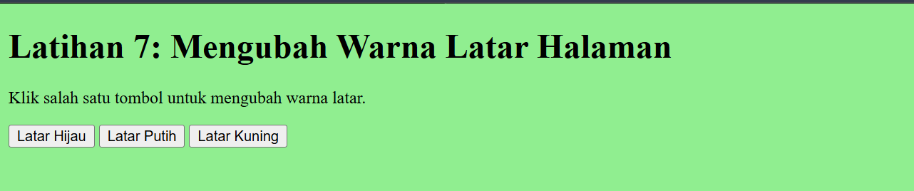

---

### 8. Latihan 8: DOM dan Checkbox Menu Makanan

**Tujuan:** menghitung total harga secara otomatis dengan event listener dan manipulasi DOM.

**Kode HTML (`latihan8.html`, bagian body):**

```html
<h3>Daftar Menu Makanan</h3>
<label><input type="checkbox" class="menu" value="5000"> Ayam Goreng — Rp5.000</label><br>
<label><input type="checkbox" class="menu" value="500"> Tempe — Rp500</label><br>
<label><input type="checkbox" class="menu" value="2500"> Telur Dadar — Rp2.500</label><br>
<p>Total: Rp<span id="total">0</span></p>
```

**Kode JavaScript (`latihan8.js`):**

```js
const daftarMenu = document.querySelectorAll(".menu");

daftarMenu.forEach((item) => {
  item.addEventListener("change", hitungTotal);
});

function hitungTotal() {
  let total = 0;
  daftarMenu.forEach((item) => {
    if (item.checked) total += Number(item.value);
  });
  document.getElementById("total").textContent = total.toLocaleString("id-ID");
}
```

**Penjelasan:**
- `querySelectorAll(".menu")` mengambil semua elemen ber-class `menu` (ketiga checkbox) sebagai satu daftar.
- `forEach` memasang event listener `change` pada setiap checkbox, sehingga `hitungTotal` berjalan setiap kali checkbox dicentang atau dilepas.
- Di dalam `hitungTotal`, total direset ke 0 lalu dijumlahkan `value` dari checkbox yang `checked`. Dihitung ulang dari awal setiap kali agar hasilnya selalu sesuai pilihan terkini.
- `toLocaleString("id-ID")` memformat angka dengan pemisah ribuan titik (misalnya `8.000`).
- Script diletakkan di akhir `<body>` agar semua checkbox sudah ada saat `querySelectorAll` dijalankan.

**Hasil pengujian:**

| Pilihan yang dicentang | Total |
|---|---|
| Tidak ada | Rp0 |
| Ayam Goreng | Rp5.000 |
| Ayam Goreng + Tempe + Telur Dadar | Rp8.000 |

Saat centang dilepas, total turun otomatis tanpa perlu menekan tombol apa pun.

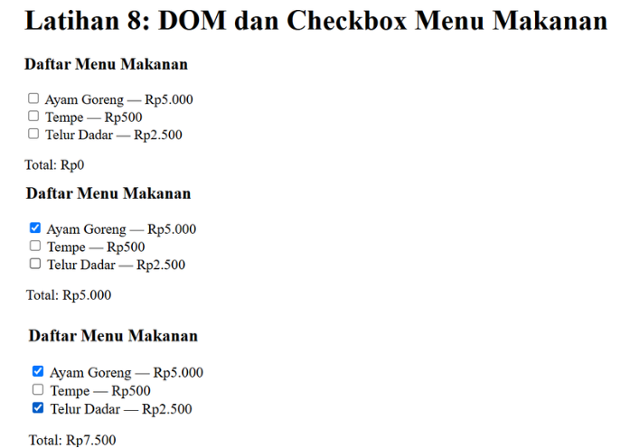

---

### 9. Mini Project: Kalkulator Nilai Mahasiswa

**Tujuan:** menggabungkan function, validasi, form, dan manipulasi DOM dalam satu program (`mini-project.html` dan `mini-project.js`).

**Ketentuan:** nilai akhir = Tugas × 30% + UTS × 30% + UAS × 40%. Mahasiswa dinyatakan **lulus** jika nilai akhir ≥ 60.

| Nilai Akhir | Predikat |
|---|---|
| ≥ 85 | A |
| ≥ 75 | B |
| ≥ 60 | C |
| ≥ 50 | D |
| < 50 | E |

**Kode HTML (bagian form):**

```html
<form id="formNilai" novalidate>
  <label for="tugas">Nilai Tugas (0-100)</label>
  <input type="number" id="tugas" step="any">

  <label for="uts">Nilai UTS (0-100)</label>
  <input type="number" id="uts" step="any">

  <label for="uas">Nilai UAS (0-100)</label>
  <input type="number" id="uas" step="any">

  <button type="submit">Hitung Nilai Akhir</button>
</form>
<div id="hasil"></div>
```

**Kode JavaScript (`mini-project.js`):**

```js
// ----- Perhitungan -----
function hitungNilaiAkhir(tugas, uts, uas) {
  return tugas * 0.30 + uts * 0.30 + uas * 0.40;
}

function tentukanPredikat(nilai) {
  if (nilai >= 85) return "A";
  if (nilai >= 75) return "B";
  if (nilai >= 60) return "C";
  if (nilai >= 50) return "D";
  return "E";
}

function tentukanStatus(nilai) {
  return nilai >= 60 ? "Lulus" : "Belum lulus";
}

//  Validasi 
function nilaiValid(teks) {
  if (teks.trim() === "") return false;
  const angka = Number(teks);
  return !Number.isNaN(angka) && angka >= 0 && angka <= 100;
}

//  Tampilan 
function tampilkanError(pesan) {
  const area = document.getElementById("hasil");
  area.innerHTML = '<div class="hasil gagal"></div>';
  area.firstChild.textContent = pesan;
}

function tampilkanHasil(akhir) {
  const area = document.getElementById("hasil");
  area.innerHTML =
    '<div class="hasil">' +
    "<strong>Nilai akhir:</strong> " + akhir.toFixed(2) + "<br>" +
    "<strong>Predikat:</strong> " + tentukanPredikat(akhir) + "<br>" +
    "<strong>Status:</strong> " + tentukanStatus(akhir) +
    "</div>";
}

// Penghubung form 
function prosesNilai(event) {
  event.preventDefault();

  const tugas = document.getElementById("tugas").value;
  const uts = document.getElementById("uts").value;
  const uas = document.getElementById("uas").value;

  if (!nilaiValid(tugas) || !nilaiValid(uts) || !nilaiValid(uas)) {
    tampilkanError("Semua nilai harus diisi dengan angka pada rentang 0-100.");
    return;
  }

  const akhir = hitungNilaiAkhir(Number(tugas), Number(uts), Number(uas));
  tampilkanHasil(akhir);
}

document.getElementById("formNilai").addEventListener("submit", prosesNilai);
```

**Penjelasan:**
- Program dibagi menjadi function dengan tugas masing-masing: **perhitungan** (`hitungNilaiAkhir`, `tentukanPredikat`, `tentukanStatus`), **validasi** (`nilaiValid`), **tampilan** (`tampilkanHasil`, `tampilkanError`), dan **penghubung** (`prosesNilai`). Pemisahan ini membuat logika perhitungan terpisah dari tampilan hasil.
- `event.preventDefault()` mencegah form memuat ulang halaman saat disubmit, sehingga hasil tetap tampil.
- `nilaiValid` menolak input kosong, bukan angka, di bawah 0, atau di atas 100.
- `akhir.toFixed(2)` membulatkan hasil menjadi dua angka di belakang koma.
- Hasil ditampilkan pada halaman HTML (elemen `#hasil`), bukan hanya di Console.

**Hasil pengujian:**

| Skenario | Tugas | UTS | UAS | Nilai Akhir | Predikat | Status |
|---|---|---|---|---|---|---|
| 1 | 85 | 78 | 88 | 84.10 | B | Lulus |
| 2 | 40 | 50 | 45 | 45.00 | E | Belum lulus |
| 3 | 120 | 80 | 70 | ditolak | - | Pesan error: di luar rentang 0-100 |
| 4 | (kosong) | 80 | 70 | ditolak | - | Pesan error: kolom wajib diisi |

Perhitungan skenario 1: (85 × 0,30) + (78 × 0,30) + (88 × 0,40) = 25,5 + 23,4 + 35,2 = 84,10.

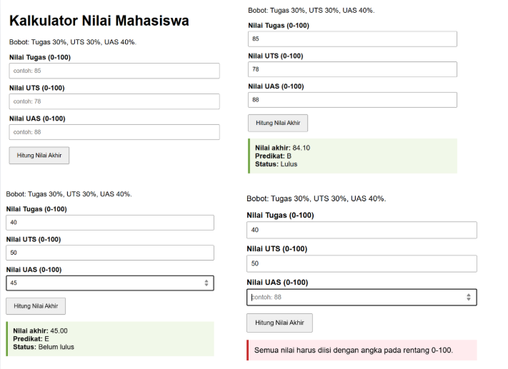

---

### 10. Eksperimen Mandiri

**Tujuan:** mengembangkan materi dengan mencoba variasi sendiri (`eksperimen.html` dan `eksperimen.js`).

**Eksperimen 1: Latihan 3 dengan input prompt**

```js
const a = Number(prompt("Masukkan bilangan pertama:"));
const b = Number(prompt("Masukkan bilangan kedua:"));
operasiDasar(a, b);
```

Input dari `prompt` dikonversi dengan `Number()` sebelum dihitung. Pada versi lengkap, input kosong, Cancel, dan non-angka dicek lebih dulu, dan modulus dengan pembagi 0 diberi pesan "Tidak dapat dibagi nol" (memperbaiki temuan `NaN` pada Latihan 3).

**Eksperimen 2: Tabel perkalian 7**

```js
for (let i = 1; i <= 10; i++) {
  console.log("7 x " + i + " = " + (7 * i));
}
```

Perulangan `for` berjalan dari `i = 1` sampai `i = 10`, menghasilkan `7 x 1 = 7` hingga `7 x 10 = 70`.

**Eksperimen 3: function `cekGenap(angka)`**

```js
function cekGenap(angka) {
  return angka % 2 === 0;
}
```

Function mengembalikan `true` jika angka genap dan `false` jika ganjil (`cekGenap(8)` → `true`, `cekGenap(5)` → `false`).

**Eksperimen 4: Validasi kolom tidak boleh kosong**

```js
if (nama === "" || kota === "") {
  hasil.textContent = "Semua kolom wajib diisi.";
} else {
  hasil.textContent = "Data diterima: " + nama + " dari " + kota + ".";
}
```

Nilai input dipotong spasinya dengan `trim()` agar isian yang hanya berisi spasi tetap dianggap kosong.

**Eksperimen 5: Menambah menu makanan**

Menambahkan dua pilihan baru pada daftar menu HTML (Tahu Goreng Rp3.000 dan Nasi Putih Rp4.000). Kode JavaScript tidak perlu diubah karena `querySelectorAll(".menu")` otomatis menangkap semua checkbox ber-class `menu`. Total jika kelima menu dicentang adalah Rp15.000.

**Eksperimen 6: Tombol tampil/sembunyi**

```js
function toggleKotak() {
  const kotak = document.getElementById("kotakToggle");
  kotak.style.display = kotak.style.display === "none" ? "block" : "none";
}
```

Setiap klik membalik nilai `display` antara `none` (tersembunyi) dan `block` (tampil).

**Hasil pengamatan:**

| No | Eksperimen | Hasil |
|---|---|---|
| 1 | Operasi dari prompt | Hasil operasi tampil di Console sesuai angka yang dimasukkan |
| 2 | Tabel perkalian 7 | 10 baris perkalian tampil dengan benar |
| 3 | `cekGenap` | `true` untuk genap, `false` untuk ganjil |
| 4 | Validasi kolom kosong | Pesan merah jika ada kolom kosong, pesan hijau jika lengkap |
| 5 | Menu 5 pilihan | Total Rp15.000 jika semua dicentang |
| 6 | Tampil/sembunyi | Elemen hilang dan muncul bergantian setiap klik |

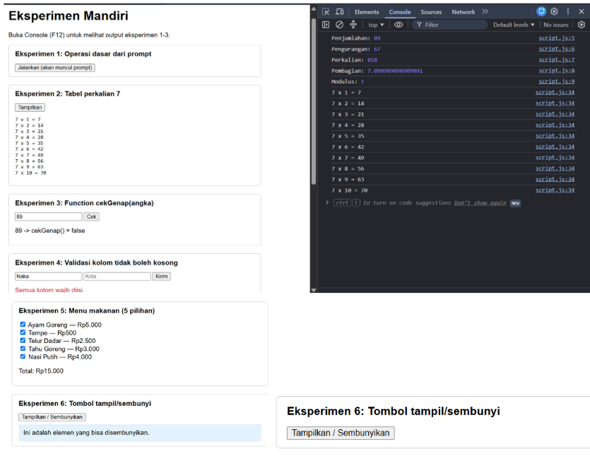

---

### 11. Validasi Form (Soal H.7)

**Tujuan:** memvalidasi form agar nama tidak kosong dan nilai berada pada rentang 0-100 (`validasi-form.html` dan `validasi-form.js`).

**Kode JavaScript (`validasi-form.js`):**

```js
function validasiForm(event) {
  event.preventDefault();

  const nama = document.getElementById("nama").value.trim();
  const teksNilai = document.getElementById("nilai").value;
  const nilai = Number(teksNilai);
  const pesan = document.getElementById("pesan");

  const daftarError = [];

  if (nama === "") {
    daftarError.push("Nama tidak boleh kosong.");
  }

  if (teksNilai.trim() === "" || Number.isNaN(nilai)) {
    daftarError.push("Nilai harus diisi dengan angka.");
  } else if (nilai < 0 || nilai > 100) {
    daftarError.push("Nilai harus berada pada rentang 0-100.");
  }

  if (daftarError.length > 0) {
    pesan.className = "error";
    pesan.textContent = daftarError.join(" ");
    return;
  }

  pesan.className = "sukses";
  pesan.textContent = "Data valid: " + nama + " dengan nilai " + nilai + ".";
}

document.getElementById("formValidasi").addEventListener("submit", validasiForm);
```

**Penjelasan:**
- Semua kesalahan dikumpulkan ke dalam array `daftarError`, sehingga pengguna melihat seluruh masalah sekaligus, bukan satu per satu.
- Jika array berisi pesan, pesan ditampilkan (kelas `error`, warna merah) dan proses berhenti dengan `return`. Jika kosong, ditampilkan pesan sukses (kelas `sukses`, warna hijau).
- Form memakai atribut `novalidate` agar validasi dilakukan oleh JavaScript dan pesannya bisa diatur sendiri, bukan oleh pesan bawaan browser.

**Hasil pengujian:**

| Nama | Nilai | Hasil |
|---|---|---|
| (kosong) | (kosong) | Dua pesan error: nama kosong dan nilai harus angka |
| `Rani` | `150` | Nilai harus berada pada rentang 0-100 |
| (kosong) | `50` | Nama tidak boleh kosong |
| `Rani` | `85` | Data valid: Rani dengan nilai 85. |

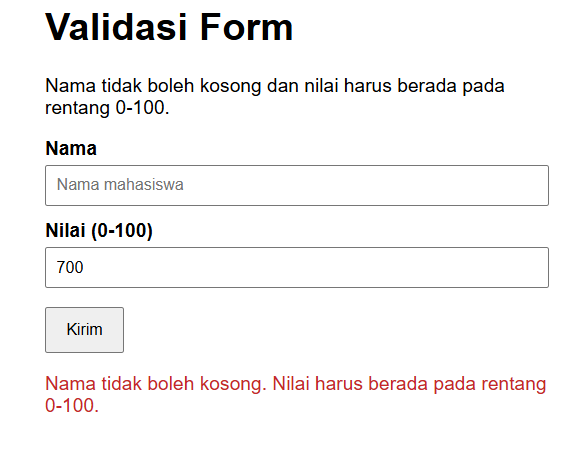

---

## Jawaban Pertanyaan

**1. Jelaskan perbedaan `console.log()`, `alert()`, `prompt()`, dan `textContent`/`innerHTML`.**
`console.log()` menulis pesan ke Console browser dan hanya terlihat oleh developer, sehingga cocok untuk debugging. `alert()` menampilkan kotak dialog berisi pesan kepada pengguna dan menghentikan halaman sementara sampai OK ditekan. `prompt()` menampilkan kotak dialog yang meminta masukan; hasilnya berupa string, atau `null` jika dibatalkan. `textContent` mengubah isi teks sebuah elemen di halaman dan memperlakukan isinya sebagai teks biasa. `innerHTML` juga mengubah isi elemen, tetapi string-nya di-parse sebagai HTML sehingga tag ikut dirender; karena itu `innerHTML` berisiko (XSS) bila dipakai dengan input dari pengguna.

**2. Apa perbedaan `let` dan `const`? Berikan contoh.**
`let` dipakai untuk variabel yang nilainya akan berubah, sedangkan `const` untuk variabel yang tidak boleh ditetapkan ulang. Contoh: `let umur = 20; umur = 21;` valid, tetapi `const nama = "Rani"; nama = "Sari";` menghasilkan error "Assignment to constant variable". Keduanya memiliki cakupan blok (`{ }`). Praktik yang baik adalah memakai `const` secara default dan `let` hanya jika nilainya memang perlu berubah.

**3. Apa perbedaan operator `==` dan `===`?**
`==` membandingkan nilai setelah melakukan konversi tipe otomatis, sedangkan `===` membandingkan nilai dan tipe tanpa konversi. Contoh: `"5" == 5` bernilai `true`, tetapi `"5" === 5` bernilai `false`; `0 == false` bernilai `true`, tetapi `0 === false` bernilai `false`. Operator `===` disarankan agar hasil perbandingan lebih mudah diprediksi dan terhindar dari bug akibat konversi tipe.

**4. Jelaskan fungsi `if-else` dan `switch`. Kapan masing-masing dapat digunakan?**
`if-else` menguji kondisi logis dan dapat memakai rentang maupun gabungan kondisi (`&&`, `||`), misalnya `nilai >= 60` pada Latihan 4. `switch` memilih satu tindakan dari sejumlah nilai pasti, misalnya angka 1-5 pada Latihan 5, dan biasanya lebih rapi ketika ada banyak pilihan nilai tetap. Pada `switch`, `break` mencegah eksekusi berlanjut ke case berikutnya dan `default` menangani nilai di luar daftar.

**5. Apa fungsi parameter dan `return` dalam function?**
Parameter adalah variabel penerima data masukan pada function, sehingga function bisa dipakai ulang dengan data berbeda (`hitungLuas(8, 4)` dan `hitungLuas(5, 3)`). `return` mengembalikan hasil perhitungan ke pemanggil agar dapat disimpan atau dipakai lagi, sekaligus mengakhiri eksekusi function. Contoh: `function hitungLuas(panjang, lebar) { return panjang * lebar; }` menghasilkan 32 untuk `hitungLuas(8, 4)`.

**6. Bagaimana JavaScript memilih elemen HTML menggunakan `document.getElementById()`?**
Method ini mencari elemen berdasarkan nilai atribut `id` dan mengembalikan objek elemen tersebut (atau `null` jika tidak ditemukan). Objek yang dikembalikan kemudian bisa dibaca atau diubah, misalnya `elemen.textContent = "Teks baru"` atau `elemen.style.color = "blue"`. Karena `id` harus unik dalam satu halaman, method ini selalu mengembalikan satu elemen. Untuk memilih banyak elemen sekaligus dipakai `querySelectorAll`, seperti pada Latihan 8.

**7. Buat script untuk memvalidasi form agar nama tidak kosong dan nilai berada pada rentang 0-100.**
Script lengkap terdapat pada bagian **11. Validasi Form (Soal H.7)** di atas, yaitu berkas `validasi-form.js`.

---

## Kendala dan Solusi

| Kendala | Solusi |
|---|---|
| Tombol F12 membuka fitur diagnosis sistem, bukan DevTools | Membuka Console dengan **Ctrl + Shift + J**, atau klik kanan → Inspect → tab Console |
| Hasil `prompt` tidak bisa dihitung sebagai angka | `prompt` selalu mengembalikan string, sehingga dikonversi dengan `Number()` dan dicek dengan `Number.isNaN()` |
| Error `Cannot set properties of null` saat memilih elemen | Script dipindah ke akhir `<body>` agar elemen sudah ada, dan `id` dipastikan sama persis dengan yang dipanggil |
| Modulus menghasilkan `NaN` pada pembagi nol | Menambahkan pengecekan `b !== 0` sebelum menghitung modulus (diterapkan pada Eksperimen 1) |
| Kotak prompt dan alert muncul beruntun jika beberapa latihan digabung dalam satu halaman | Setiap latihan dipisah menjadi berkas HTML dan JS sendiri |
| Form memuat ulang halaman sehingga hasil hilang | Menambahkan `event.preventDefault()` pada event `submit` |
| Gambar screenshot tidak tampil di README | Nama file harus sama persis dengan yang ditulis pada README (huruf kecil semua), dan file berada di lokasi yang sesuai |

## Kesimpulan

Dari praktikum ini dipahami bahwa JavaScript menjadikan halaman web interaktif. Variabel (`let`, `const`), tipe data, dan operator dipakai untuk menyimpan serta mengolah data. Percabangan (`if-else`, `switch`) menentukan alur program berdasarkan kondisi, dan perulangan (`for`, `while`) menjalankan instruksi berulang. Function dengan parameter dan `return` membuat kode dapat dipakai ulang dan memisahkan logika perhitungan dari tampilan. Melalui DOM, elemen HTML dapat dipilih (`getElementById`, `querySelectorAll`) lalu diubah teks maupun gayanya, sedangkan event listener memungkinkan halaman bereaksi terhadap aksi pengguna. Validasi input penting karena data dari `prompt` dan form selalu berupa string dan dapat berisi nilai yang tidak diharapkan, sehingga perlu dikonversi dan diperiksa sebelum diproses.

## Checklist Pengumpulan

- [x] Latihan 1-8 dikerjakan dan diuji
- [x] Output ditampilkan melalui halaman, Console, alert, dan prompt
- [x] Function, percabangan (`if-else`, `switch`), dan perulangan digunakan
- [x] Manipulasi DOM, event listener, dan perubahan gaya elemen dicoba
- [x] Form dan validasi input dengan JavaScript dicoba
- [x] Mini project kalkulator nilai menampilkan hasil di halaman HTML
- [x] Eksperimen mandiri dikerjakan
- [x] Jawaban pertanyaan Bagian H tersedia
- [x] Screenshot setiap latihan dan README.md tersedia
- [x] Repository `Lab5Web` di-commit dan URL siap dikirim
